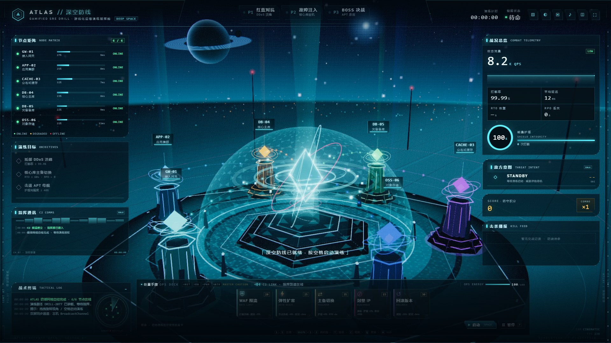
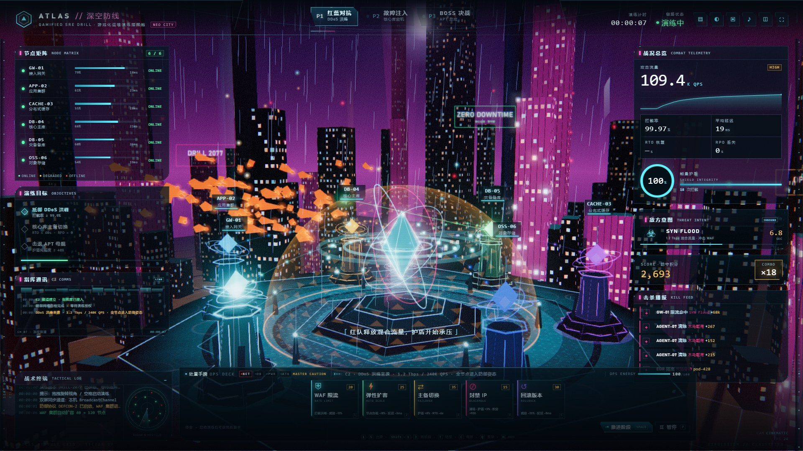
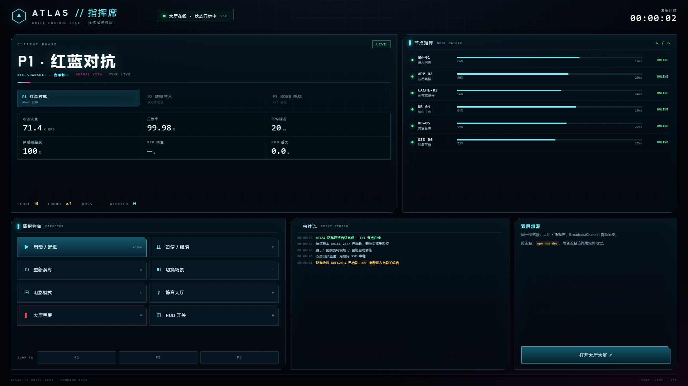
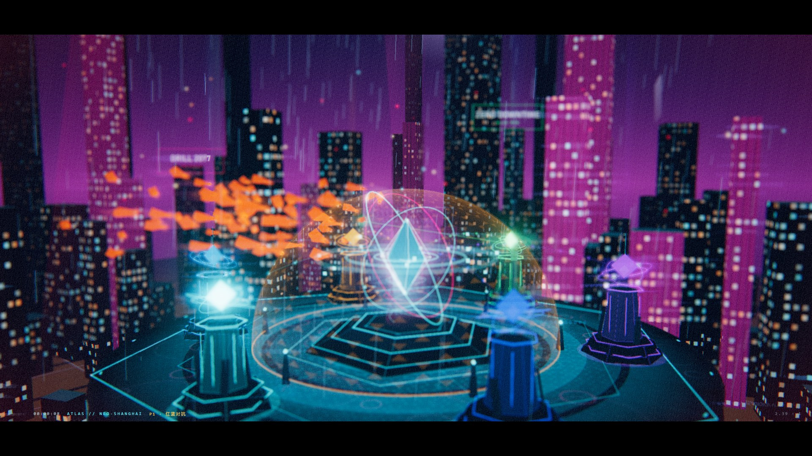
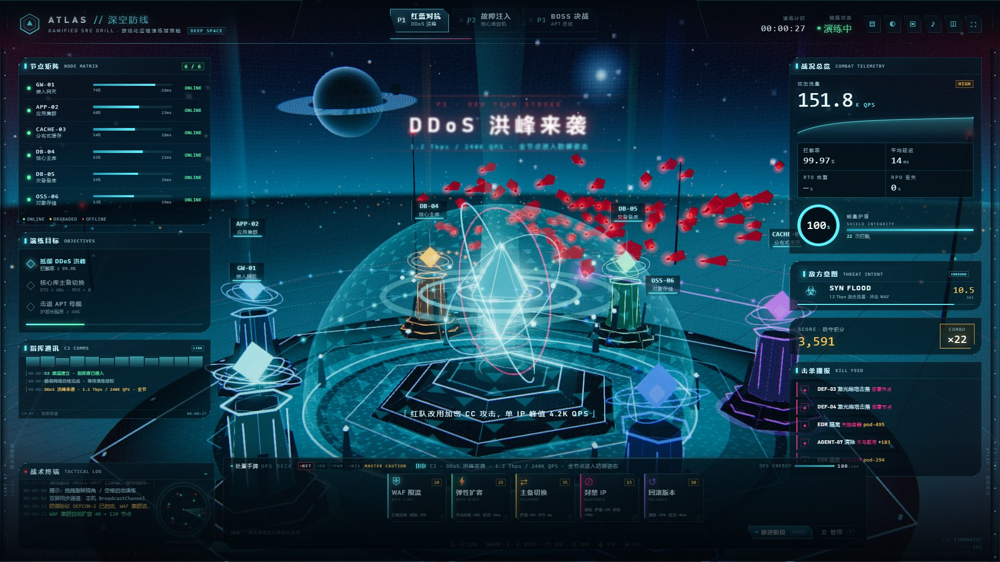
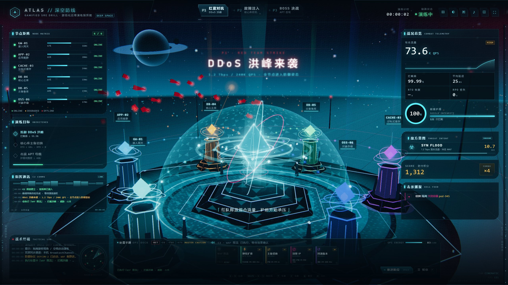
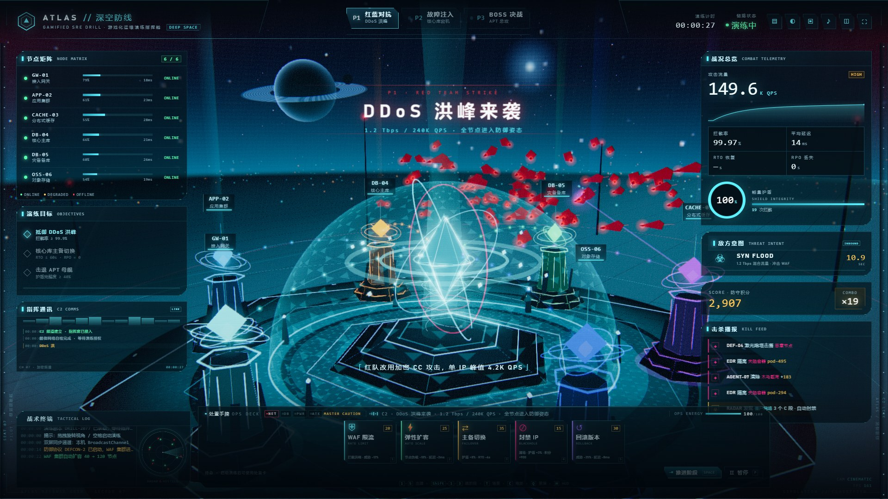
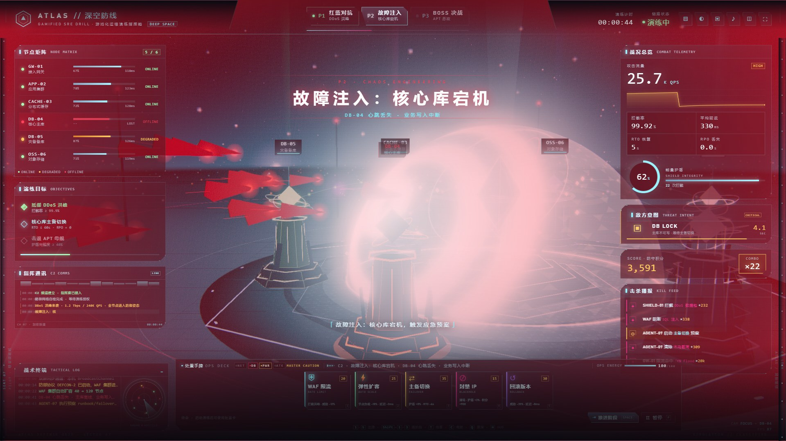
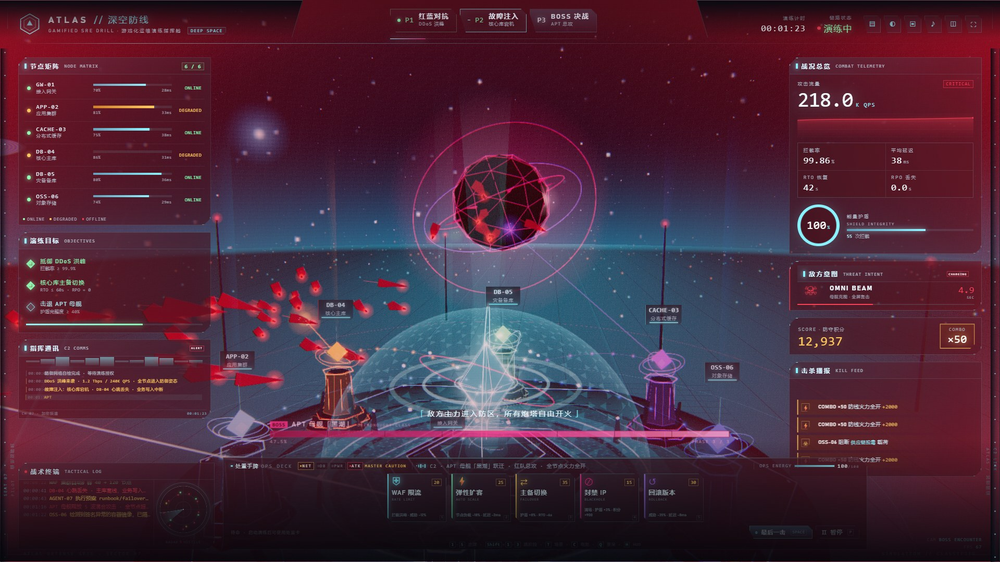

# ATLAS // 深空防线 · 赛博都市

> 把 IT 运维演练大屏做成“能看懂的游戏”：DDoS 洪峰是敌舰群，故障注入是基地起火，主备切换是能量重连，APT 总攻是 Boss 决战。



一个**可直接双击运行、无需后端、无需联网**的游戏化演练大屏原型，现已升级为：

- **双主题**：`DEEP SPACE` 星港防线 / `NEO-SHANGHAI` 雨夜赛博都市，按 `T` 或点击 `◐` 无刷新切换；
- **双屏**：大厅大屏 + 独立「指挥席」控制台，支持本机 `BroadcastChannel` 与局域网 SSE 中继；
- **电影模式**：2.39:1 遮幅、电影调色、景深（DoF）、FXAA、变形宽银幕光晕、导演机位轮切、REC 时间码，按 `C` 一键进入。

基于 Three.js / WebGL 实时渲染；星云、行星、天际线、霓虹、雨、护盾、粒子与音效全部程序化生成。主页面 `dist/index.html` 约 720 KB，控制台 `dist/console.html` 约 28 KB，两者都无外部图片 / 音频依赖。

**在线演示**：<https://whllowp.github.io/atlas-deep-space-drill/>  
**在线指挥席**：<https://whllowp.github.io/atlas-deep-space-drill/console.html>

---

## 1. 三个新增能力

### ① 主题切换：从星港到赛博都市



- **DEEP SPACE**：星云、环带行星、深空城市灯光、六边形星港平台、数据核心与能量护盾。
- **NEO-SHANGHAI**：230 栋程序化霓虹楼宇（GLSL 窗格 + 霓虹接缝）、雨幕、街区车流、空中车流、全息广告、巨型基座、探照灯与紫红夜空。
- 切换时黑色扫描转场，约 0.6 秒完成；主题写入 `localStorage`，刷新保持。
- URL 直接指定：`?theme=city` / `?theme=space`。

### ② 双屏：指挥席 + 大厅



- 大厅右上角 `▤` 打开指挥席，或直接访问 `/console`（Pages 地址见文首）。
- 指挥席可控制：启动/推进、暂停、重播、切换场景、电影模式、静音、大厅黑屏、HUD 开关、跳转 P1/P2/P3。
- 同步通道自动选择：
  - **同浏览器 / 同源**：`BroadcastChannel`（GitHub Pages 上即可用）；
  - **跨设备 / 局域网**：`npm run dev` 启动 SSE 中继，两台设备访问 `http://<LAN-IP>:5178/` 与 `/console`；
  - 静态文件 / 无中继：`localStorage` 事件兜底。
- 大厅以 4 Hz 广播状态快照（阶段、指标、节点、日志、主题、电影/黑屏状态），指挥席实时回显。

### ③ 电影模式



- 2.39:1 遮幅 + 电影调色（提亮高光、青蓝阴影、加强暗角与颗粒）。
- 深度景深：焦点自动跟随镜头目标，近景塔身与远景天际线虚化；高光带轻微横向变形光晕与 halation。
- 4 组导演机位每 8.5 秒轮切：低机位广角、核心特写、俯拍三分之四、侧面长焦；阶段事件（P2 故障、P3 Boss）优先接管。
- 轻微手持漂移与滚转，后期 FXAA 平滑边缘（不使用 MSAA，避免部分驱动天空变黑）。
- HUD 与 3D 节点标签自动隐藏，仅保留左下角 `REC · 时间码 · 场景 · 阶段 · 2.39:1`。
- URL：`?cine=1`；快捷键 `C`；指挥席可远程切换；`Q` 临时开关景深。

---

## 2. 三十秒上手

1. **直接双击** `dist/index.html`（Chrome / Edge），点击「启动演练」或按 <kbd>Space</kbd>。
2. 重新构建：`npm install && npm run build`（同时产出 `dist/index.html` 与 `dist/console.html`）。
3. 本地预览 + 局域网同步：`npm run dev` → <http://127.0.0.1:5178/>，指挥席 <http://127.0.0.1:5178/console>。
4. 自动演示：`dist/index.html?auto=1`；纯净画面：`?hud=0`；指定主题：`?theme=city`；电影模式：`?cine=1`；低配机：`?quality=low`（关闭默认景深、限制 DPR）。

> 声音需一次点击/按键后才能启动（浏览器自动播放策略）。多屏跨设备必须通过 `npm run dev` 的 HTTP 服务访问，`file://` 双开不保证同步。

### 操作

| 操作 | 功能 |
|---|---|
| `Space` | 启动 / 推进下一阶段 / 完成后重开 |
| `P` | 暂停 / 继续 |
| `T` | 切换星港 / 赛博都市 |
| `C` | 电影模式开关 |
| `Q` | 景深开关（电影模式） |
| `B` | 大厅黑屏 / 恢复 |
| 鼠标拖拽 | 自由环视（7 秒后自动回到导演机位） |
| 滚轮 | 推拉镜头 |
| `M` | 静音 / 恢复 |
| `F` | 全屏 |
| `H` | 隐藏 / 显示 HUD |
| `R` | 重新开始 |
| `1`–`5` | 打出对应处置卡（WAF / 扩容 / 切换 / 封禁 / 回滚） |
| `Shift`+`1`/`2`/`3` | 直接跳到 P1 / P2 / P3（彩排用） |

### 驾驶舱 + 处置手牌

按 `设计风格.md` 的推荐组合落地：**方案 A 驾驶舱 HUD + 方案 C 卡牌构筑**。3D 战场保留，外围增加座舱梁、玻璃反光、侧轨与底部 OPS DECK；手牌负责表达“处置策略”的选择与代价。

| 卡牌 | 能量 | 冷却 | 效果 |
|---|---|---|---|
| WAF 限流 | 20 | 7s | 拦截率 +，威胁 -12%，积分 +1200 |
| 弹性扩容 | 25 | 11s | 节点负载 -18%，延迟 -2ms，积分 +1500 |
| 主备切换 | 35 | 16s | 护盾 +8%，RTO -6s，积分 +1800 |
| 封禁 IP | 15 | 6s | 清空当前敌舰，护盾 +3%，积分 +900 |
| 回滚版本 | 30 | 15s | 威胁 -35%，延迟 -8ms，积分 +2000 |



- **OPS ENERGY** 初始 100，演练中 7/s 回复；出牌扣能量，冷却期间卡面变暗并显示倒计时。
- 四盏 **MASTER CAUTION** 灯对应 NET / DB / PWR / ATK，随阶段与护盾状态点亮。
- 左侧 **C2 COMMS**：滚动通话记录、打字机、波形、`LINK / ALERT / END` 状态。
- 战术终端右侧新增 **RADAR**：扫描扇区、节点绿/黄/红点、敌对红点与 HOSTILE 计数。
- 右侧 **THREAT INTENT** 显示下一步敌方行动：P1 SYN FLOOD、P2 DB LOCK、P3 OMNI BEAM，带倒计时与进度条。
- C2 通讯条回显阶段公告与出牌回执；所有操作同步写入战术终端。
- 结算卡新增 S 评级虚线印章、积分滚动、本局出牌序列、MVP 与 **复制战报**。
- 迭代拆分与验收见 **[docs/design-iterations.md](docs/design-iterations.md)**（10/10 完成）。



---

## 3. 演练剧本（约 95 秒）

| 阶段 | 时间 | 游戏化演出 | 运维含义 |
|---|---|---|---|
| **P1 红蓝对抗** | 0–34s | 预警「DDoS 洪峰来袭」，敌舰群从防区外突入，六座炮塔激光齐射，护盾涟漪，连击与击杀播报刷屏 | 1.2 Tbps / 240K QPS 混合流量，WAF 限流、自动扩容，拦截率 99.97% |
| **P2 故障注入** | 34–64s | 镜头推近 DB-04，核心库塔爆炸起火、熄灭、变为 OFFLINE；备用塔点亮，绿色修复环扩散，镜头切至 DB-05 | 主库心跳丢失、写入中断，执行 `runbook/failover-db.sh`，RTO 42s / RPO 0s |
| **P3 BOSS 决战** | 64–94s | APT 母舰「黑潮」跃迁入场，Boss 血条、母舰光束轰击护盾，全节点过载，最后一击后母舰爆炸 | 红队总攻 + 全链路压测 + 供应链投毒载荷隔离，最终 S 级评价 |
| **战报** | 94s+ | S 级结算卡：总积分、最高连击、拦截次数、RTO / RPO、护盾剩余 | 演练复盘数据 |





---

## 4. 游戏化映射

| 真实指标 | 本项目的游戏化呈现 |
|---|---|
| 服务器 / 集群节点 | 六座带能量光柱的六边形防御塔，塔顶晶体颜色区分服务 |
| 网络流量 / 并发 | 塔与核心之间的流光管道 + 突破防线的敌舰群 |
| CPU / 内存负载 | 节点矩阵负载条与 `DEGRADED` 状态；塔体亮度随威胁变化 |
| DDoS / 安全攻击 | 红色敌舰波次；撞上护盾时扩散涟漪并扣护盾 |
| 防火墙 / 拦截策略 | 半球六边形能量护盾 + 炮塔激光拦截网 |
| 故障注入 | DB-04 塔爆炸、起火、熄灭、红灯闪烁、显示 `OFFLINE` |
| 应急响应 / 恢复 | 备库接管的绿色修复环、护盾能量回路重置、镜头聚焦 |
| 演练整体进度 | P1/P2/P3 阶段条 + Boss 血条 + 目标进度条 |
| 演练结果 | S 级战报卡 + 积分 / 连击 / 拦截数 / RTO / RPO |
| 击杀播报 | 右上角 KILL FEED，含干员名、武器、拦截量与加分 |
| 全局事件广播 | 全息公告（入侵警报 / 故障注入 / 切换完成 / Boss 跃迁） |
| 操作日志 | 战术终端 + 指挥席事件流，带时间戳滚动输出 |
| 双主题 | 星港 = “太空防线”；赛博都市 = “城市级数据中心防线” |

设计原则：

1. **数据驱动特效**：没有事件时画面静谧呼吸；只有故障/攻击发生才爆发粒子与警报。
2. **游戏是氛围，HUD 是事实**：RTO、RPO、拦截率、节点状态始终固定显示，保证“中看也中用”。
3. **性能预算**：实例化舰群、粒子池 2200、DPR 上限 1.75、Bloom 单 pass、城市楼宇单 draw call。

---

## 5. 技术实现

- **渲染**：Three.js r160 + `EffectComposer`（RenderPass → UnrealBloomPass → ScreenFX → OutputPass）
- **后处理**：Bloom、Bokeh 景深、FXAA、暗角、色差、扫描线、胶片颗粒、警报红边、电影调色（`uCine`）、高光横向光晕与 halation
- **电影模式**：BokehPass 聚焦镜头目标；FXAA 在 OutputPass 之后做边缘平滑；4 组机位 + 手持漂移；2.39:1 遮幅
- **双主题**：`spaceRoot` / `CityTheme` 两组场景对象，切换只改可见性、雾、曝光、护盾色，不重建 WebGL
- **赛博都市**：`InstancedMesh` + 自定义 GLSL（世界坐标窗格、随机亮灯、霓虹接缝、距离雾）；雨幕 `LineSegments`；车流 `Points`；全息广告 CanvasTexture
- **护盾**：半球网格 + 自定义 GLSL（菲涅尔 + 六边形格 + 4 个命中涟漪槽位）
- **战斗**：实例化敌舰 + 轨迹 + 点光晕；激光对象池；GPU 粒子池；Boss 光束与死亡爆裂
- **运镜**：自定义 Cinematic Rig（yaw/pitch/dist/fov/target 阻尼插值）+ 4 组导演机位；命中震屏
- **双屏同步**：`src/sync.js`（SSE / BroadcastChannel / localStorage 三级降级）+ `server.mjs` SSE 中继
- **打包**：esbuild 双入口，JS/CSS 全内联，`file://` 直接可运行

### 目录

```
├─ dist/index.html           # 大厅大屏（单文件，双击即用）
├─ dist/console.html         # 指挥席控制台
├─ index.html                # GitHub Pages 入口（跳转 dist）
├─ console.html              # 指挥席入口（跳转 dist/console.html）
├─ src/
│  ├─ main.js                # 渲染器 / 后处理 / 主题 / 电影模式 / 同步
│  ├─ sim.js                 # 演练状态机与数据（替换这里接真实监控）
│  ├─ world.js               # 星港场景、节点、护盾、核心
│  ├─ city.js                # 赛博都市场景（天际线/雨/车流/广告）
│  ├─ game.js                # 战斗、Boss、粒子、导演镜头
│  ├─ hud.js                 # 大屏 HUD 与战报
│  ├─ console.js             # 指挥席逻辑
│  ├─ sync.js                # 多屏同步总线
│  ├─ audio.js               # WebAudio 合成音效
│  ├─ utils.js               # 程序化贴图与 Shader
│  ├─ style.css              # 大屏 HUD 视觉规范
│  ├─ console.css            # 指挥席视觉规范
│  ├─ index.template.html    # 大屏 HTML 壳
│  └─ console.template.html  # 指挥席 HTML 壳
├─ server.mjs                # 静态预览 + SSE 中继（0.0.0.0）
├─ build.mjs                 # 双页面构建
├─ tools/capture.cjs         # 生成 docs 截图
└─ docs/                     # 截图与接入手册
```

---

## 6. 接入真实数据（Prometheus / Zabbix / 演练编排引擎）

当前 `src/sim.js` 用计时器模拟剧本。生产接入推荐：

```
Prometheus / Zabbix / CMDB / 演练编排引擎
        ↓ (HTTP / Kafka / MQTT)
Telemetry Adapter（新增，1–2 Hz 聚合）
        ↓ 更新 sim.state.metrics / sim.state.nodes
        ↓ 事件映射：sim.emit('fault', 3) / sim.emit('repair', 4) / sim.emit('boss', true)
Three.js 演出层 + HUD + 指挥席（无需改动）
```

最小示例：

```js
// src/telemetry.js（示例，不在当前构建中）
const ws = new WebSocket('wss://ops.example.com/drill/stream');
ws.onmessage = (ev) => {
  const d = JSON.parse(ev.data);
  const m = sim.state.metrics;
  m.qps = d.qps;
  m.intercept = d.blockRate;
  m.latency = d.p95;
  m.shield = d.shield;
  d.nodes.forEach((n, i) => {
    sim.state.nodes[i].load = n.cpu;
    sim.state.nodes[i].latency = n.latency;
    sim.state.nodes[i].status = n.status;
  });
  if (d.event === 'DB_FAILOVER_START') sim.emit('fault', 3);
  if (d.event === 'DB_FAILOVER_DONE') sim.emit('repair', 4);
  if (d.event === 'APT_BOSS_ENTER') sim.emit('boss', true);
  if (d.event === 'DRILL_COMPLETE') sim.finish();
};
```

事件契约、阈值建议、去抖与多屏同步说明见 **[docs/telemetry.md](docs/telemetry.md)**。

---

## 7. 自定义

| 想改什么 | 改哪里 |
|---|---|
| 六个节点的名称 / 角色 / 颜色 / 方位 | `src/world.js` 顶部 `NODES` |
| 演练阶段时长、台词、触发点 | `src/sim.js` 的 `PHASES` 与 `runTimeline()` |
| 星港场景 / 行星 / 护盾 | `src/world.js`、`src/utils.js` |
| 赛博都市天际线密度 / 雨量 / 广告文案 / 霓虹配色 | `src/city.js` |
| 主题切换、电影模式、同步命令 | `src/main.js` |
| 导演机位 | `src/game.js` 的 `setCamGoal()`、`cineShot` |
| 指挥席布局 / 按钮 | `src/console.template.html`、`src/console.css`、`src/console.js` |
| 品牌名 / 主色 / 字体 | `src/style.css`、`src/console.css` 的 `:root` |
| 跨设备中继端口 / 绑定地址 | `server.mjs`（`PORT` / `HOST`） |

---

## 8. 性能与验收

- 1920×1080 / DPR 1.75：普通模式目标 45–60 FPS（真机 GPU；headless SwiftShader 数值不代表真机）
- 2560×1440 与 3840×2160 已验证无横向/纵向溢出；4K 下 HUD 字号上限 30px
- 1280×720 自动隐藏 C2 面板并上移 Boss 血条；≤1180 隐藏左栏与击杀播报，保留手牌
- 电影模式开启 DoF 会额外渲染一次深度：独显/游戏本无压力；核显可按 `Q` 关闭景深，或使用 `?quality=low`
- 赛博都市：230 栋楼 = 1 个 instanced draw call；雨 850 线段；车流 260 点；空中车流 90 点；湿地涟漪 96 段圆盘
- 电影模式：调色/暗角/光晕 + 深度景深；FXAA 替代 MSAA，避免纹理天空在部分驱动上变黑
- 大屏机建议：Chrome 独占全屏、DPR 锁 1.0–1.5；4K 屏把 DPR 调到 1.0
- 多屏：`npm run dev` 后两台设备访问局域网地址；同一浏览器可直接 BroadcastChannel
- 无外部网络请求，断网可运行

**验收路径**：
1. 打开大厅 → `T` 切换都市 → `C` 进入电影模式（景深/光晕/遮幅）→ `Q` 关闭景深 → 退出；
2. 另开指挥席 → 启动 → 暂停 → 切换场景 → 跳 P2 → 黑屏/恢复；
3. 跑完整 P1→P2→P3 → S 级战报 → 再次演练。

---

## 9. 已知限制 / 下一步

- 赛博都市是**风格化**程序化场景，不是 UE5 级写实；没有 SSAO / 真实 DOF / 光追。
- 处置手牌只在**大厅**可用；指挥席负责全局控制，不显示/操作单卡。
- 1024×768 为简化布局：隐藏左栏、雷达与击杀播报，保留手牌与核心 KPI。
- 跨设备同步依赖 `npm run dev` 的 SSE 中继；GitHub Pages 只能同源 BroadcastChannel。
- `file://` 双开不保证同步；多屏请走 HTTP。
- 声音需一次用户手势后启动。
- 机甲指挥舱主题尚未实现；`sim` 与 HUD/命令层可复用。
- 若追求电影级写实，可将 `sim` 作为数据源，用 UE5 + Pixel Streaming 输出场景，HUD 与事件契约直接复用。

---

*ATLAS // DRILL-2077 · 双主题 / 双屏 / 电影模式 · 游戏化运维演练大屏原型*
